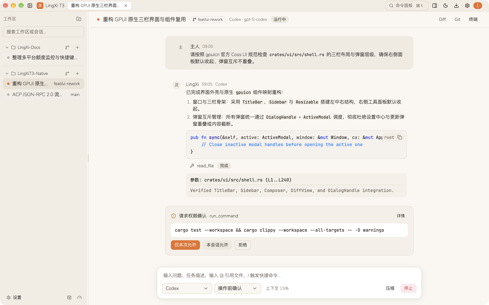
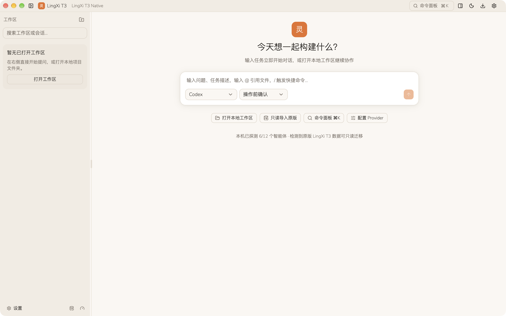
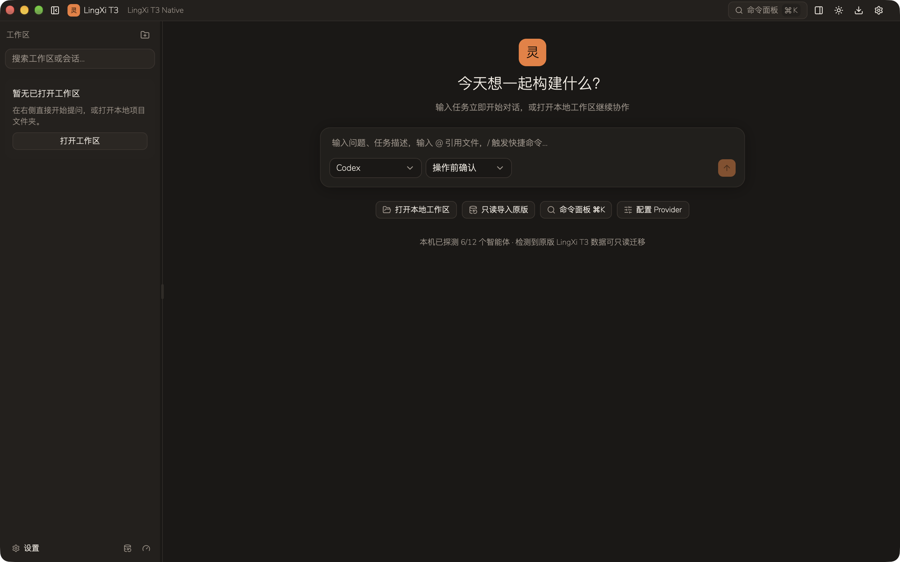
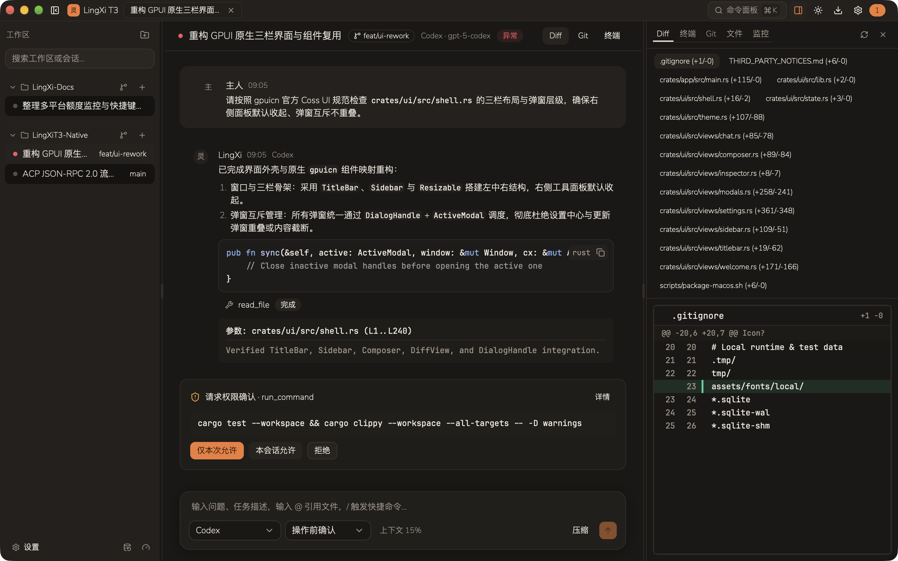
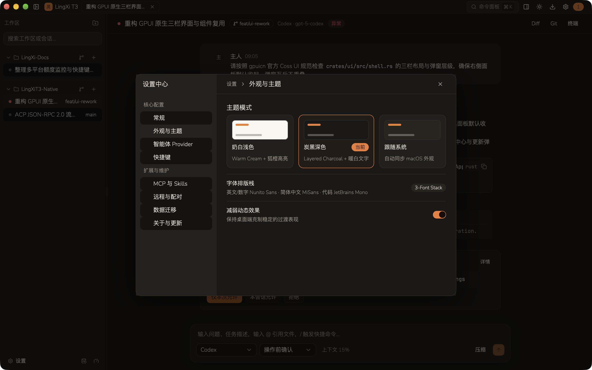
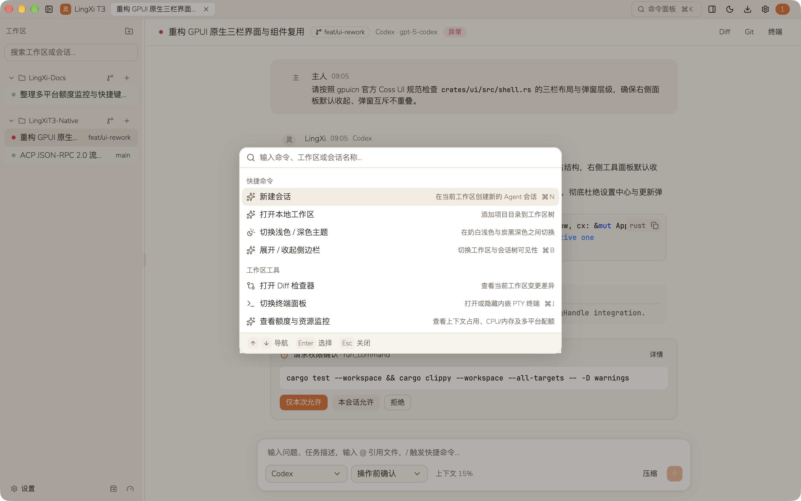

<div align="center">

# LingXi T3 Native

**基于 Rust + GPUI + gpuicn 原生重构的 AI Coding Harness 桌面工作台**

*Zero Electron · Zero Chromium · Zero Node.js — ~21.8 MiB RSS · Native GPU Rendering*

[-E45A26?style=flat-square&logo=rust&logoColor=white)](https://www.rust-lang.org/)
[](https://github.com/karyalabs/gpuicn)
[](Cargo.toml)
[](#快速开始)
[](LICENSE)

<br />

<picture>
  <source media="(prefers-color-scheme: dark)" srcset="docs/screenshots/chat-dark.png" />
  <source media="(prefers-color-scheme: light)" srcset="docs/screenshots/chat-light.png" />
  
</picture>

</div>

---

## 为什么做原生重构（Why Native）

**LingXi T3 Native** 是 [LingXiFox/t3code](https://github.com/LingXiFox/t3code)（基线 `5e8e265`）的纯 Rust 原生桌面端重构版本。它以 GPU 加速的 [GPUI](https://www.gpui.rs/)、[gpuicn](https://github.com/karyalabs/gpuicn) 与 [GPUI Kit](https://github.com/longbridge/gpui-kit) 替代 Electron / Chromium / Node.js 运行时，将常驻内存压低至 **~21.8 MiB**，同时完整保留多 Agent 编排、ACP 协议、终端、Git Diff 与配额监控能力。

- **严格身份与数据隔离**：使用独立应用标识 `com.lingxifox.lingxit3.native`、独立数据目录 `~/.lingxi-t3-native` 与协议 `lingxit3-native://`，绝不覆盖或修改旧版 `~/.lingxi-t3` 数据。
- **内存安全基线**：整个 Workspace 启用 `unsafe_code = "deny"`，核心状态采用事件溯源与 SQLite WAL 单事务持久化。

---

## 界面预览（Interface Gallery）

| 奶白浅色主题 · 欢迎页 | 炭黑深色主题 · 欢迎页 |
| :---: | :---: |
|  |  |
| **三栏聊天流 · 浅色主题** | **Diff 检查器 · 深色主题** |
|  |  |
| **设置中心 · 外观与主题** | **命令面板 (`⌘K`)** |
|  |  |

---

## 核心特性

### 1. 精致原生设计系统与排版
- **独立双主题配色**：Warm Cream 浅色（`#FAF7F2` / `#F3EEE6`）与 Layered Charcoal 深色（`#1A1816` / `#141312`），搭配**狐橙**（`#F07C38`）语义强调色；克制使用阴影，禁止毛玻璃与多余动态装饰。
- **4 级 Elevation 层级**：Level 0（无阴影画布与无边框 Agent 正文）→ Level 1（悬浮 Composer）→ Level 2（下拉框与命令面板 `⌘K`）→ Level 3（设置、更新与权限弹窗）。
- **中英代码三字体栈**：英文/数字采用 `Nunito Sans`（SIL OFL 1.1），代码/Diff/终端采用 `JetBrains Mono`（SIL OFL 1.1），简体中文优先 `MiSans` 并内置系统回退链。详情见 [字体与许可说明](docs/font-licensing.md)。

### 2. Event-Sourced Orchestration V2
- **纯决策核心**：`Orchestrator` 与 `EventSink` 分离，在单个 SQLite WAL 事务内原子写入事件、物化投影、命令回执与 Outbox。
- **并发与崩溃恢复**：`EffectWorker` 异步调度外部副作用，启动时自动检测未完成 Turn 并恢复为可继续状态。

### 3. 12 路原生 Provider 与 ACP (JSON-RPC 2.0)
开箱探测并支持 12 种 Agent 运行时与自定义 ACP 服务：

`Codex` · `Claude Code` · `Antigravity` · `DeepSeek Harness (dsh --profile acp)` · `Cursor` · `Grok` · `OpenCode` · `Pi` · `Muse Code` · `Kiro` · `fx` · `Custom ACP Registry`

### 4. 内置 Coding Harness 工作台
- **可折叠右侧检查器**：按需展开 `Diff`（原生 `DiffView`）、`终端`（`portable-pty` 多标签真实 Shell）、`Git`（分支、工作区状态、PR 与隐藏 Ref Checkpoint）、`文件`、`监控`（`sysinfo` 资源占用 + 6 平台额度与上下文追踪）。
- **扩展与远程能力**：内置 Axum `/mcp` HTTP 服务端与本地 Skills 扫描、T3 兼容 WebSocket/RPC 远程服务端、Stable / Nightly 双通道自动更新器。
- **只读旧版数据迁移**：严格以 `SQLITE_OPEN_READ_ONLY` 打开 `~/.lingxi-t3/userdata/statev2.sqlite`，导入前自动生成原生数据库时间戳备份并支持回滚。

---

## Workspace 架构（15 Crates）

| Crate | 职责 |
| --- | --- |
| [`lingxi-app`](crates/app) | 桌面主入口、CLI 参数模式（`--bench` / `--headless-server` / `--import-legacy` 等）与动作分发 |
| [`lingxi-ui`](crates/ui) | GPUI + `gpuicn` 三栏外壳、Design Tokens、字体加载、主题与全部视图/弹窗 |
| [`lingxi-domain`](crates/domain) | 核心领域模型（Workspace、Thread、Message、Approval、Checkpoint 等） |
| [`lingxi-orchestration`](crates/orchestration) | Event-Sourced V2 编排器、命令路由、Outbox 与崩溃恢复 |
| [`lingxi-providers`](crates/providers) | 12 路 Provider 本地探测、版本识别与驱动适配 |
| [`lingxi-acp`](crates/acp) | JSON-RPC 2.0 over stdio ACP 客户端与会话/工具事件流 |
| [`lingxi-storage`](crates/storage) | SQLite WAL 持久化、迁移与只读旧版数据导入 |
| [`lingxi-workspace`](crates/workspace) | 工作区目录扫描、文件搜索、`@` 引用索引与路径边界校验 |
| [`lingxi-git`](crates/git) | Git 状态、`Diff` 生成、`gh` PR 集成与隐藏 Ref Checkpoint 管理 |
| [`lingxi-terminal`](crates/terminal) | 基于 `portable-pty` 的多标签跨平台伪终端会话 |
| [`lingxi-mcp`](crates/mcp) | Axum `/mcp` 服务端与本地 Skills 目录发现 |
| [`lingxi-telemetry`](crates/telemetry) | `sysinfo` CPU/内存遥测、上下文百分比与多平台额度追踪 |
| [`lingxi-remote`](crates/remote) | T3 兼容 WebSocket / HTTP 远程服务端与 Scoped Token 鉴权 |
| [`lingxi-platform`](crates/platform) | macOS / Linux / Windows 路径、钥匙串与系统集成 |
| [`lingxi-updater`](crates/updater) | Stable / Nightly 双通道更新检查、SHA-256 校验与回滚 |

---

## 快速开始

### 环境要求
- **Rust**：`1.98+`（Edition 2024）
- **操作系统**：macOS（Apple Silicon / Intel）、Linux 或 Windows

### 1. 克隆并拉取可选本地中文字体

仓库已内置开源字体 `Nunito Sans` 与 `JetBrains Mono`（SIL OFL 1.1）。如需在开发与打包时启用小米 `MiSans` 简体中文字体（该目录在 `.gitignore` 中排除，不会进入公共 Git）：

```bash
git clone https://github.com/LingXiFox/LingXiT3-Native.git
cd LingXiT3-Native
./scripts/fetch-local-fonts.sh
```

### 2. 构建与运行

```bash
# 运行原生桌面应用
cargo run --release --bin lingxi-t3-native

# 格式检查、Clippy 零告警检查与全量测试
cargo fmt --all -- --check
cargo clippy --workspace --all-targets -- -D warnings
cargo test --workspace
```

### 3. CLI 运维与诊断模式

```bash
cargo run --release --bin lingxi-t3-native -- --check-startup      # 无头启动与 SQLite 自检
cargo run --release --bin lingxi-t3-native -- --probe-providers    # 探测本机 12 路 Provider 状态
cargo run --release --bin lingxi-t3-native -- --bench              # 运行性能基准测试
cargo run --release --bin lingxi-t3-native -- --headless-server    # 启动无头 WebSocket 远程服务
cargo run --release --bin lingxi-t3-native -- --import-legacy ~/.lingxi-t3/userdata/statev2.sqlite
```

### 4. macOS 应用打包（`.app` & `.dmg`）

```bash
./scripts/package-macos.sh
# 产物输出至 dist/LingXi T3 Native.app 与 dist/LingXiT3-Native-0.1.0-macos-arm64.dmg
```

---

## 性能基准快照（Release `--bench`）

在 Apple Silicon macOS 上执行 `cargo run --release --bin lingxi-t3-native -- --bench` 的实测结果：

| 指标 | 实测值 |
| --- | --- |
| 常驻内存占用（`rss_mib`） | `21.80 MiB` (`22,855,680 B`) |
| 10,000 会话树过滤耗时 | `1.47 ms` |
| 500 块流式 Markdown（35 KB）解析 | `8.64 ms` |
| SQLite WAL 写入 1,000 条消息 | `170.09 ms` |
| SQLite WAL 读取 1,000 条消息 | `0.43 ms` |

---

## 文档索引

- [架构设计说明](docs/architecture.md)
- [UI 视觉精修与验收报告](docs/ui-visual-qa.md)
- [字体许可与分发策略](docs/font-licensing.md)
- [性能基准测试报告](docs/benchmarks/performance-report.md)
- [Phase 0 审计报告](docs/audit/phase0-audit.md)
- [协议兼容矩阵](docs/audit/protocol-compatibility.md)
- [功能迁移验收矩阵](docs/audit/feature-matrix.md)
- [Phase 10 最终验收报告](docs/acceptance-report.md)

---

## 开源协议与致谢

本项目基于 [MIT License](LICENSE) 开源 — Copyright (c) 2026 T3 Tools Inc. (Ping Labs / T3 Code) & LingXiFox。
第三方开源组件与字体许可详情请参阅 [THIRD_PARTY_NOTICES.md](THIRD_PARTY_NOTICES.md) 与 [docs/font-licensing.md](docs/font-licensing.md)。
